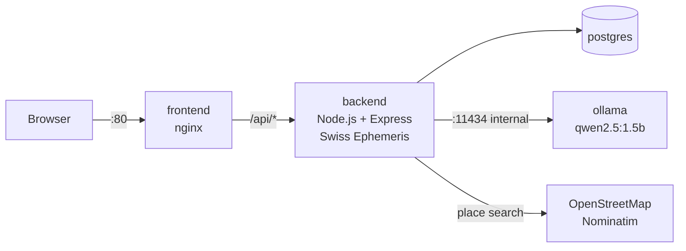

# Ayu AI

**Ayu** (Sanskrit *āyu*, "life") reads your **age**, your **health** and your **Vedic birth chart** together on one page, then a **self-hosted AI model** writes a short personal summary of all three.

It merges two earlier projects, [age-calculator-website](https://github.com/DineshRawal013/age-calculator-website) and HealthCheck, and adds AI insight, a database, a kundali and a deployment pipeline.

## Features

**Age**
- Exact age in years, months and days, a live seconds counter, totals and a next-birthday countdown

**Health**
- BMI, BMR (Mifflin–St Jeor), TDEE, water estimate, reference weight range, waist-to-height ratio
- Habit inputs: sleep, smoking, alcohol
- **Alerts** ranked by severity, including predictions ("at +300 kcal/day your BMI may pass 25 in 12 weeks")
- **Charts**: habit-balance radar and a 12-week weight projection for three intake scenarios

**Lifeline (just for fun)**
- Remaining-years estimate: country/sex life-expectancy baseline, adjusted for BMI, activity, smoking, alcohol, sleep and waist, with each factor shown

**Kundali (traditional, cultural interest)**
- Birth place search (OpenStreetMap), with time zone and historical offsets resolved automatically
- North Indian birth chart, planet table, lagna, rashi, nakshatra and pada
- **Animated planet wheel** from your date of birth to today, with play/pause, speed and a date slider. Natal positions show as faint rings and Jupiter/Saturn/Rahu sign changes are logged. It ends in **live mode** with today's sky moving in real time.
- Vimshottari dasha timeline with the current period marked
- Traditionally challenging periods (Sade Sati, Ashtama Shani, difficult dasha combinations), worded gently
- Astrology is never used for the lifespan estimate and never predicts death or illness

**AI insight**
- Ollama running **qwen2.5:1.5b** in its own container, with no external API and no API key
- The backend computes every number and the model only explains them, streamed word by word
- Saved with the result, so a shared link shows the same text

**History**
- Each reading is stored anonymously in PostgreSQL and opens again with a share link (`/?r=<id>`)

## Architecture



| Container | Image | Public port | Role |
|---|---|---|---|
| `frontend` | `nginx:1.27-alpine` | 80 | Static page, proxies `/api` and streams the AI text |
| `backend` | `node:20-bookworm-slim` | — | All calculations, kundali, database, AI prompt |
| `postgres` | `postgres:16-alpine` | — | Anonymous result history |
| `ollama` | `ollama/ollama` | — | Local LLM, downloads the model on first start |

```text
ayu-ai/
├── backend/            Express API
│   ├── src/
│   │   ├── server.js   routes
│   │   ├── age.js      exact age
│   │   ├── health.js   metrics, alerts, 12-week projection
│   │   ├── lifespan.js fun lifespan estimate
│   │   ├── kundali.js  Swiss Ephemeris, dasha, challenging periods, transits
│   │   ├── ai.js       Ollama prompt + streaming
│   │   ├── geo.js      Nominatim place search
│   │   └── db.js       PostgreSQL
│   ├── test/
│   └── Dockerfile
├── frontend/           index.html, style.css, app.js, kundali.js, nginx.conf, Dockerfile
├── ollama/entrypoint.sh
├── deploy/setup-vm.sh
├── .github/workflows/deploy.yml
└── docker-compose.yml
```

## Run locally

Requires Docker Desktop.

```bash
git clone https://github.com/DineshRawal013/ayu-ai.git
cd ayu-ai
cp .env.example .env          # then edit POSTGRES_PASSWORD (and HTTP_PORT=8080 if port 80 is busy)
docker compose up --build
```

Open http://localhost (or http://localhost:8080). The first start downloads the AI model (~1 GB). Until it finishes, results still work but the AI read says the model is downloading. Follow it with:

```bash
docker compose logs -f ollama
```

Backend tests:

```bash
cd backend && npm ci && npm test
```

## Deploy to Azure (VM + GitHub Actions)

On every push to `main`, GitHub Actions runs the tests, builds the `backend` and `frontend` images, pushes them to GitHub Container Registry, then SSHes into the VM and restarts the containers.

### 1. Create the VM

In the Azure portal (or with the Azure CLI below):

- Image: **Ubuntu Server 24.04 LTS**
- Size: **Standard_B2ms** (2 vCPU, 8 GB RAM). The AI model runs on CPU.
- Authentication: **SSH public key**
- Inbound ports: **22** and **80** (and **443** for HTTPS, see step 5)

```bash
az group create -n ayu-rg -l koreacentral
az vm create -g ayu-rg -n ayu-vm --image Ubuntu2404 --size Standard_B2ms \
  --admin-username azureuser --generate-ssh-keys --public-ip-sku Standard
az vm open-port -g ayu-rg -n ayu-vm --port 80
```

### 2. Prepare the VM (one time)

```bash
scp deploy/setup-vm.sh azureuser@<VM_IP>:~
ssh azureuser@<VM_IP> 'bash setup-vm.sh'
```

This installs Docker, adds swap and creates `~/ayu-ai/.env` with a random database password.

### 3. Add GitHub secrets

Repo → **Settings → Secrets and variables → Actions → New repository secret**:

| Secret | Value |
|---|---|
| `VM_HOST` | VM public IP |
| `VM_USER` | `azureuser` |
| `VM_SSH_KEY` | Contents of your **private** key (e.g. `~/.ssh/id_rsa`) |

### 4. Deploy

Push to `main` (or run the workflow from the **Actions** tab). The site appears at `http://<VM_IP>`. The first deploy takes a few extra minutes while the VM downloads the model.

### 5. HTTPS (optional)

1. Give the VM's public IP a **DNS name label** (Public IP → Configuration), set it to **Static**, and open inbound port **443**.
2. Add to `~/ayu-ai/.env` on the VM (use your own DNS name):
   ```
   DOMAIN=ayu-ai.koreacentral.cloudapp.azure.com
   COMPOSE_PROFILES=https
   HTTP_PORT=127.0.0.1:8080
   ```
3. Run `cd ~/ayu-ai && docker compose up -d` on the VM, or redeploy. Caddy gets a free Let's Encrypt certificate and redirects HTTP to HTTPS.

To save Azure credit, stop the VM when you aren't using it: `az vm deallocate -g ayu-rg -n ayu-vm`.

## API

| Method | Path | Purpose |
|---|---|---|
| `POST` | `/api/analyze` | Age, health, lifespan and kundali in one call; saves and returns an `id` |
| `GET` | `/api/results/:id` | Load a saved reading |
| `POST` | `/api/results/:id/insight` | Stream the AI insight (plain text) |
| `GET` | `/api/kundali/transits?from=ISO&to=ISO` | Planet longitudes for the animated wheel |
| `GET` | `/api/kundali/now` | Current sidereal planet positions |
| `GET` | `/api/geo/search?q=` | Birth place search |
| `GET` | `/api/countries` | Countries with life-expectancy baselines |
| `POST` | `/api/age` | Original age endpoint, kept for compatibility |
| `GET` | `/api/status` | Database and AI health |

## How the numbers are made

- **Health**: BMI = kg / m²; BMR by Mifflin–St Jeor; TDEE = BMR × activity factor; water ≈ 0.033 L/kg; waist-to-height = waist / height.
- **Projection**: energy balance at 7,700 kcal per kg, recalculating TDEE each week as weight changes.
- **Lifespan**: life expectancy at birth by country and sex (UN Population Division estimates, via Worldometer), plus a small survivorship bonus for having reached your current age, plus rounded habit effects from large population studies (e.g. current smoking −10 years). It is a fun estimate, not a prediction.
- **Kundali**: Swiss Ephemeris (Moshier), Lahiri ayanamsa, mean node for Rahu, whole-sign houses, Vimshottari dasha with 365.25-day years. If birth time is missing, noon is used and the lagna may be wrong.

## Privacy

Readings are saved **without name, email or IP address**, but they include date, time and place of birth plus health inputs. Anyone with a share link can open that reading. The AI runs on the same server, so data is never sent to an AI company. Place search queries go to OpenStreetMap's Nominatim.

## Disclaimer

Ayu AI is an educational and entertainment tool, not a medical device. Health formulas are screening estimates. The lifespan figure is just for fun. Vedic astrology is shown as a cultural tradition with no proven predictive power. For medical questions, see a qualified healthcare professional.

## License

MIT, see [LICENSE](LICENSE).
